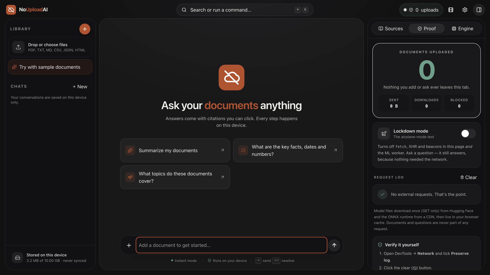
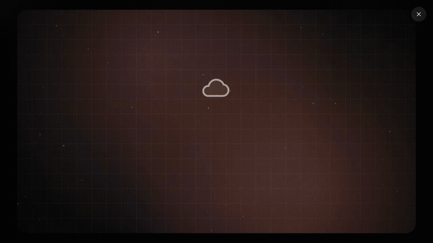

<div align="center">
  
</div>

<h1 align="center">Chat with your documents. Nothing leaves your browser.</h1>

<p align="center">
  <strong>NoUploadAI</strong> is a local-first retrieval-augmented generation (RAG) workspace.
  Drop in a PDF or text file, ask questions, and get answers whose claims link back to the
  exact paragraph and page — with a live on-screen proof of every network request the tab makes.
</p>

<p align="center">
  
</p>

<p align="center">
  <a href="#how-it-works">How it works</a> ·
  <a href="FEATURES.md">Features</a> ·
  <a href="PRIVACY.md">Privacy model</a> ·
  <a href="PROJECT_SUMMARY.md">Project summary</a> ·
  <a href="MEDIA.md">Media</a> ·
  <a href="SHOWCASE_NOTICE.md">Showcase notice</a>
</p>

---

## Why this exists

Most "chat with your PDF" tools send your file to a server. That is a non-starter for contracts,
medical notes, research drafts, board decks and anything else you are not allowed to hand to a
third party. NoUploadAI moves the entire pipeline — parsing, chunking, embedding, indexing,
retrieval and answer generation — into the browser tab.

The result is a workspace that works without an account, without a backend and without an upload
button. Documents and conversations live in IndexedDB on the device. A visible *Network Proof*
panel counts real outbound uploads (the counter starts at zero and stays there) and lists the
requests that do occur, so the privacy claim can be inspected instead of trusted.

## Highlights

| | |
|---|---|
| **Local RAG** | pdf.js parsing, sentence-aware chunking, hybrid BM25 + dense retrieval, reciprocal rank fusion |
| **Cited answers** | Every answer carries numbered sources; click one to see the passage, match scores and the original PDF page |
| **Two generation modes** | A zero-download extractive composer, or an optional local LLM (SmolLM2, Qwen2.5, Llama 3.2) with WebGPU where available and WASM fallback |
| **Verifiable privacy** | Instrumented `fetch`/XHR/beacon, a request log, upload counter, lockdown switch and per-answer request receipts |
| **Installable** | PWA manifest, service worker, offline app shell, themes, command palette, drag & drop and paste |
| **Self-contained build** | `npm run build` emits a single ~2.2 MB `dist/index.html` plus three small PWA files |

## How it works

```text
  local file ──▶ pdf.js / text reader ──▶ page-aware chunker ──▶ embedder (worker)
       │                                                             │
       │                                                             ▼
       │                                                     IndexedDB vectors
       │                                                             │
       └────────────────── question ──▶ BM25 + cosine ──▶ RRF ───────┘
                                                    │
                                                    ▼
                                    extractive composer / local LLM
                                                    │
                                                    ▼
                                     streamed answer + clickable sources
```

1. **Ingest** — supported PDFs and text-like files are read in-page. Flat files are paginated so citations still read like "page 3".
2. **Chunk & embed** — a sentence-aware chunker keeps each chunk inside one page. Embeddings run in a Web Worker using either a built-in 384-dimensional hashing embedder (no download) or a small neural model cached in the browser.
3. **Retrieve** — a BM25 index and cosine similarity over the stored vectors are fused with reciprocal rank fusion, then the top matches become numbered sources.
4. **Answer** — the default extractive composer builds a cited answer from those passages; optionally a local instruction model generates one from a strictly grounded prompt.
5. **Verify** — the Inspector exposes the evidence and the network log. Nothing about your documents is sent anywhere.

See [FEATURES.md](FEATURES.md) for the detailed feature map and [PRIVACY.md](PRIVACY.md) for the exact network and storage behaviour, including caveats.

## See it in motion

<p align="center"></p>

<p align="center">
  <a href="launch-film.gif"></a><br />
  <a href="launch-film.mp4">Download the 45-second launch film (MP4)</a>
</p>

The film is drawn in real time on a Canvas 2D surface with a synthesized WebAudio score. The MP4
here is a screen capture of the in-app player (video only); the GIF is a short excerpt.

## Try it locally

The full application source lives in the private companion repository:

**`git@github.com:avartan007/NoUploadAI-SRC.git`** — <https://github.com/avartan007/NoUploadAI-SRC>

Access can be granted to recruiters and hiring teams on request. With the source available:

```bash
git clone git@github.com:avartan007/NoUploadAI-SRC.git
cd NoUploadAI-SRC
npm install
npm run dev        # http://localhost:5173
npm run build      # single-file output in dist/
npm run preview
```

Node.js 20+ and a modern Chromium/Firefox/Safari build are recommended. WebGPU is optional;
the app falls back to WASM. To use the zero-download path end to end, choose **Instant hashing**
as the embedder and **Instant · Extractive** as the generator in Model Center.

## Companion demos in this repository

`studio/` contains three small, runnable, client-side utilities (image compression, EXIF scrubbing,
SVG optimization) that illustrate the same "no upload" design philosophy. They are concept demos
hosted here for the showcase; they are **not** part of the NoUploadAI application build.

- [Studio tools overview](studio/index.html)
- [Compress](studio/compress.html) · [Scrub](studio/scrub.html) · [Optimize SVG](studio/svg.html)

## Repository layout

| Repository | Visibility | Contents |
|---|---|---|
| [`NoUploadAI-SRC`](https://github.com/avartan007/NoUploadAI-SRC) | Private | Complete application source, 21 incremental commits, no docs/media in its history |
| [`NoUploadAI`](https://github.com/avartan007/NoUploadAI) | Public | This repository: documentation, screenshots, recordings, logo and the standalone studio demos |

Keeping the two apart is deliberate: the public repository exists so recruiters can evaluate the
work without the implementation being copied into somebody else's project. See
[REPO_SETUP.md](REPO_SETUP.md) and [SHOWCASE_NOTICE.md](SHOWCASE_NOTICE.md).

## Built with

React 19 · TypeScript 5.9 · Vite 7 · Tailwind CSS 4 · Zustand · Framer Motion · pdf.js 5 ·
Transformers.js 4 (runtime CDN) · WebGPU/WASM · IndexedDB · Web Workers · Canvas 2D · WebAudio ·
Service Workers · single-file build plugin.

## Author

Avartan Athlay — <https://github.com/avartan007>

> This is a portfolio showcase. Documentation and media are public; implementation source is
> private and available on request. Hard-coded figures inside the launch film and landing
> showcase are illustrative presentation copy, not live telemetry.
